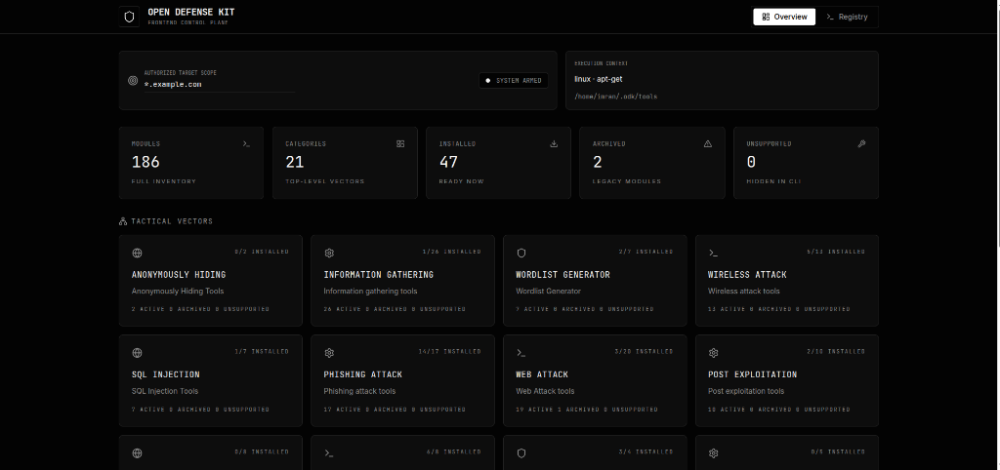

<div align="center">

# Open Defense Kit (ODK)

**Ethical, Defense-First Security Toolkit & Audit Environment**

[](https://github.com/imranshiundu/open-defense-kit/actions/workflows/ci.yml)
[](https://github.com/imranshiundu/open-defense-kit/actions/workflows/install.yml)
[](LICENSE)
[](https://www.python.org/)
[](#)
[](#)
[](https://github.com/imranshiundu/open-defense-kit/stargazers)

</div>

<div align="center">
  
</div>

---

## Mission

Open Defense Kit is an ethical, legal, **defense-first** security toolkit. It is built as a safer replacement for unsafe all-in-one "hacking tool" launchers: every module is documented, risk-rated, permission-gated, and safe by default.

ODK is two things at once:

1. **A defensive engine (`odkit`)** — a pure-Python, zero-dependency audit core that scans code you own for exposed secrets, risky legacy patterns, and file-hygiene problems, then renders a graded professional report.
2. **A curated, safety-rated tool reference** — the well-known security tools are cataloged with explicit risk levels so learners know *what exists, what it does, and what it takes to use it legally* — without ODK automating anything harmful.

## The Non-Negotiable Rule

**Use this project only on systems, accounts, networks, repositories, domains, and applications you own or have explicit written permission to test.**

ODK is not, and will never be, a phishing kit, malware kit, botnet tool, DDoS tool, credential-theft tool, RAT builder, or unauthorized exploitation framework. Offensive categories below are kept as *reference-only context* and are excluded from automation by the safety model.

---

## The Audit Report — ODK's flagship module

`odkit audit-report` runs three local-only scanners (exposed secrets, risky legacy patterns, file hygiene) against any path you own and renders a single graded report as **HTML, Markdown, or JSON**. The target is only ever **read** — nothing is executed, nothing leaves your machine.

```bash
odkit audit-report ./my-project
```

```text
ODK audit report 3fa1c2de for /home/user/my-project
Grade: C  |  files scanned: 214  |  findings: 7
CRITICAL: 1  HIGH: 3  MEDIUM: 2  LOW: 1
Pass --html/--json/--markdown to render a full report.
```

```bash
# Full dark-themed HTML report, JSON for CI, markdown for PR comments:
odkit audit-report ./my-project --html report.html --json report.json --markdown report.md

# Skip test fixtures (they intentionally contain fake secrets):
odkit audit-report ./my-project --exclude tests,fixtures --html report.html
```

What the HTML report gives you: a **posture grade (A–F)**, per-severity counts, finding tables with file/line/severity/preview, and derived recommendations. It is fully self-contained (inline CSS, zero external assets) so you can attach it to a ticket, an email, or a client deliverable.

**See a real example:** [`docs/demo-audit-report.html`](docs/demo-audit-report.html) — an audit of a sample project with planted secrets, a risky deploy script, and loose file permissions ([JSON version](docs/demo-audit-report.json)).

Severity model:

| Severity | Weight | Examples |
| --- | --- | --- |
| `CRITICAL` | ×10 | private key markers, AWS access-key patterns |
| `HIGH` | ×5 | generic API keys, committed `.env`/`id_rsa`, policy-prohibited tooling references |
| `MEDIUM` | ×2 | remote script execution, raw shell calls, world-writable files |
| `LOW` | ×1 | blind `git clone` patterns |

---

## The `odkit` core package

Every module is local-only, typed, and unit-tested:

| Module | What it does | Risk |
| --- | --- | --- |
| `odkit.report` | Multi-scanner audit → graded HTML/Markdown/JSON report | LOW |
| `odkit.modules.local_secret_patterns` | Detects API keys, AWS keys, private-key markers in text files | LOW |
| `odkit.legacy_audit` | Static pattern review of legacy/quarantined code | LOW |
| `odkit.migration_classifier` | Decides KEEP_SAFE / REWRITE_SAFE / DOCS_ONLY / LAB_ONLY_DOCS / REMOVE / PROHIBITED per file | LOW |
| `odkit.command_guard` | Classifies command arrays and blocks dangerous patterns before anything runs | LOW |
| `odkit.safety` | RiskLevel model, permission gates, authorization statements | LOW |

Other CLI commands:

```bash
odkit doctor            # project health check
odkit safety            # print the safety rules
odkit permission <t>    # print the authorization statement for target t
odkit modules list      # documented modules with risk levels
odkit modules info <slug>
odkit scan-secrets <path>
odkit audit-legacy <path> [--markdown]
odkit classify-legacy <path> [--markdown]
```

### Safety model

Modules declare a `RiskLevel`; the engine enforces it:

| Level | Meaning | Automated? |
| --- | --- | --- |
| `LOW` | Local, read-only, no network | Yes |
| `MEDIUM` | Needs explicit authorization statement | Gated |
| `HIGH` | Lab-only, extra review required | No |
| `PROHIBITED` | Never automated by ODK | **Never** |

---

## Installation

### One-liner (recommended)

```bash
curl -sSL https://raw.githubusercontent.com/imranshiundu/open-defense-kit/main/install.sh | sudo bash
```

This handles everything — installs prerequisites, clones the repo, sets up a venv, and creates the `odk` command.

### Manual install

```bash
git clone https://github.com/imranshiundu/open-defense-kit.git
cd open-defense-kit
sudo python3 install.py
```

Then run `odk` (the interactive console) — or use the audit core directly:

```bash
pip install -e .
odkit audit-report ./your-repo --html report.html
```

## Docker

```bash
git clone https://github.com/imranshiundu/open-defense-kit.git
cd open-defense-kit

docker build -t odk .

# Option A — direct:
docker run -it --rm odk

# Option B — compose (recommended):
docker compose up -d
docker exec -it odk bash
python3 odk.py
```

## Web dashboard

`odk-web/` contains a FastAPI + React/Vite control plane for browsing the tool catalog and running safe modules with job persistence. See `odk-web/README.md`.

---

## Tool reference (safety-rated)

The catalog is organized by what the tools are **for**. Every category carries a safety rating from ODK's model. Ratings describe how ODK treats the category — not how dangerous each upstream tool is.

### Defensive & audit tooling — rated LOW/MEDIUM

| Category | Rating | Purpose | Representative tools |
| --- | --- | --- | --- |
| [Information gathering / recon](#information-gathering-tools) | MEDIUM | Map your own attack surface | nmap, Amass, theHarvester, Subfinder, httpx, RustScan, Masscan, SpiderFoot, TruffleHog, Gitleaks |
| [Forensics](#forensic-tools) | LOW | Investigate incidents on systems you own | Autopsy, Wireshark, Volatility 3, Binwalk, bulk_extractor, pspy |
| [Cloud security](#cloud-security-tools) | LOW | Audit your own cloud posture | Prowler, ScoutSuite, Trivy, Pacu (lab) |
| [Mobile security](#mobile-security-tools) | LOW | Audit your own apps | MobSF, Frida, Objection |
| [Steganography](#steganography-tools) | LOW | Data-hiding analysis for CTFs and forensics | StegCracker, snow10 |
| [Reverse engineering](#reverse-engineering-tools) | MEDIUM | Understand binaries and malware you own | Ghidra, Radare2, jadx, Androguard |
| [Anonymity research](#anonymously-hiding-tools) | MEDIUM | Understand operational privacy | anonsurf, multitor |
| [Wordlists & credential audit](#wordlist-generator) | MEDIUM | Test password policy on systems you own | Hashcat, John the Ripper, Cupp, haiti |

<details>
<summary><strong>Red-team reference only — rated HIGH / PROHIBITED (click to expand)</strong></summary>

> These categories are documented for **awareness, defense planning, and lab study only**. ODK's safety model marks them `HIGH` (lab-only) or `PROHIBITED` (never automated). ODK will not build, wrap, automate, or "improve" them. They appear here because defenders need to know these techniques exist.

| Category | Rating | Why it is cataloged |
| --- | --- | --- |
| [Web attack / vulnerability testing](#web-attack-tools) | HIGH | Lab-only; requires written authorization — OWASP ZAP, Nikto, Nuclei, ffuf, mitmproxy |
| [SQL injection testing](#sql-injection-tools) | HIGH | Lab-only against your own apps — sqlmap, DSSS |
| [XSS testing](#xss-attack-tools) | HIGH | Lab-only — DalFox, XSStrike |
| [Wireless testing](#wireless-attack-tools) | HIGH | Lab-only; disruption risk — Wifite, Airgeddon, hcxdumptool |
| [Post-exploitation & C2](#post-exploitation-tools) | PROHIBITED | Reference for defenders detecting C2 — never automated |
| [Payload creation](#payload-creation-tools) | PROHIBITED | Reference for defenders detecting payloads — never automated |
| [Exploit frameworks](#exploit-framework) | PROHIBITED | Reference — never automated |
| [Phishing / social engineering](#phishing-attack-tools) | PROHIBITED | Reference for awareness training and detection — never automated |
| [DDoS](#ddos-attack-tools) | PROHIBITED | Reference for capacity planning and detection — never automated |
| [RAT](#remote-administrator-tools--rat-) | PROHIBITED | Reference — never automated |
| [Social-media bruteforce](#socialmedia-bruteforce) | PROHIBITED | Reference — never automated |
| [Android / mobile attack](#android-hacking-tools) | PROHIBITED | Reference — never automated |

</details>

<details>
<summary>Full alphabetical catalog (click to expand)</summary>

### Anonymously Hiding Tools
- [Anonymously Surf](https://github.com/Und3rf10w/kali-anonsurf)
- [Multitor](https://github.com/trimstray/multitor)

### Information gathering tools
- [Network Map (nmap)](https://github.com/nmap/nmap)
- [Dracnmap](https://github.com/Screetsec/Dracnmap)
- Port scanning
- Host to IP
- [Xerosploit](https://github.com/LionSec/xerosploit)
- [RED HAWK (All In One Scanning)](https://github.com/Tuhinshubhra/RED_HAWK)
- [ReconSpider (For All Scanning)](https://github.com/bhavsec/reconspider)
- IsItDown (Check Website Down/Up)
- [Infoga - Email OSINT](https://github.com/m4ll0k/Infoga)
- [ReconDog](https://github.com/s0md3v/ReconDog)
- [Striker](https://github.com/s0md3v/Striker)
- [SecretFinder (like API & etc)](https://github.com/m4ll0k/SecretFinder)
- [Find Info Using Shodan](https://github.com/m4ll0k/Shodanfy.py)
- [Port Scanner - rang3r](https://github.com/floriankunushevci/rang3r)
- [Breacher](https://github.com/s0md3v/Breacher)
- [theHarvester (OSINT)](https://github.com/laramies/theHarvester)
- [Amass (Attack Surface Mapping)](https://github.com/owasp-amass/amass)
- [Masscan (Fast Port Scanner)](https://github.com/robertdavidgraham/masscan)
- [RustScan (Modern Port Scanner)](https://github.com/RustScan/RustScan)
- [Holehe (Email → Social Accounts)](https://github.com/megadose/holehe)
- [Maigret (Username OSINT)](https://github.com/soxoj/maigret)
- [httpx (HTTP Toolkit)](https://github.com/projectdiscovery/httpx)
- [SpiderFoot (OSINT Automation)](https://github.com/smicallef/spiderfoot)
- [Subfinder (Subdomain Enumeration)](https://github.com/projectdiscovery/subfinder)
- [TruffleHog (Secret Scanner)](https://github.com/trufflesecurity/trufflehog)
- [Gitleaks (Git Secret Scanner)](https://github.com/gitleaks/gitleaks)

### Wordlist Generator
- [Cupp](https://github.com/Mebus/cupp)
- [WordlistCreator](https://github.com/Z4nzu/wlcreator)
- [Goblin WordGenerator](https://github.com/UndeadSec/GoblinWordGenerator.git)
- [Password list (1.4 Billion Clear Text Password)](https://github.com/Viralmaniar/SMWYG-Show-Me-What-You-Got)
- [Hashcat (Password Cracker)](https://github.com/hashcat/hashcat)
- [John the Ripper](https://github.com/openwall/john)
- [haiti (Hash Type Identifier)](https://github.com/noraj/haiti)

### Wireless attack tools *(HIGH — lab only)*
- [WiFi-Pumpkin](https://github.com/P0cL4bs/wifipumpkin3)
- [pixiewps](https://github.com/wiire/pixiewps)
- [Bluetooth Honeypot GUI Framework](https://github.com/andrewmichaelsmith/bluepot)
- [Fluxion](https://github.com/FluxionNetwork/fluxion)
- [Wifiphisher](https://github.com/wifiphisher/wifiphisher)
- [Wifite](https://github.com/derv82/wifite2)
- [EvilTwin](https://github.com/Z4nzu/fakeap)
- [Fastssh](https://github.com/Z4nzu/fastssh)
- Howmanypeople
- [Airgeddon (Wireless Attack Suite)](https://github.com/v1s1t0r1sh3r3/airgeddon)
- [hcxdumptool (PMKID Capture)](https://github.com/ZerBea/hcxdumptool)
- [hcxtools (PMKID/Hash Conversion)](https://github.com/ZerBea/hcxtools)
- [Bettercap (Network/WiFi/BLE MITM)](https://github.com/bettercap/bettercap)

### SQL Injection Tools *(HIGH — lab only)*
- [Sqlmap tool](https://github.com/sqlmapproject/sqlmap)
- [NoSqlMap](https://github.com/codingo/NoSQLMap)
- [Damn Small SQLi Scanner](https://github.com/stamparm/DSSS)
- [Explo](https://github.com/dtag-dev-sec/explo)
- [Blisqy - Exploit Time-based blind-SQL injection](https://github.com/JohnTroony/Blisqy)
- [Leviathan - Wide Range Mass Audit Toolkit](https://github.com/leviathan-framework/leviathan)
- [SQLScan](https://github.com/Cvar1984/sqlscan)

### Phishing attack tools *(PROHIBITED — reference only)*
- [Setoolkit](https://github.com/trustedsec/social-engineer-toolkit)
- [dnstwist (typosquatting detection)](https://github.com/elceef/dnstwist)
- [Evilginx3](https://github.com/kgretzky/evilginx2)
- [QRLJacking (OWASP reference)](https://github.com/OWASP/QRLJacking)
- Pyphisher, AdvPhishing, SocialFish, HiddenEye, I-See_You, SayCheese, QR Code Jacking, BlackEye, ShellPhish, BlackPhish, Maskphish — cataloged for awareness training and phishing-detection engineering.

### Web Attack tools *(HIGH — lab only)*
- Skipfish
- [SubDomain Finder](https://github.com/aboul3la/Sublist3r)
- [CheckURL](https://github.com/UndeadSec/checkURL)
- [Blazy (Also Find ClickJacking)](https://github.com/UltimateHackers/Blazy)
- [Sub-Domain TakeOver](https://github.com/edoardottt/takeover)
- [Dirb](https://gitlab.com/kalilinux/packages/dirb)
- [Nuclei (Vulnerability Scanner)](https://github.com/projectdiscovery/nuclei)
- [ffuf (Web Fuzzer)](https://github.com/ffuf/ffuf)
- [Feroxbuster (Directory Brute Force)](https://github.com/epi052/feroxbuster)
- [Nikto (Web Server Scanner)](https://github.com/sullo/nikto)
- [wafw00f (WAF Detector)](https://github.com/EnableSecurity/wafw00f)
- [Katana (Web Crawler)](https://github.com/projectdiscovery/katana)
- [Gobuster (Dir/DNS/Vhost Brute Force)](https://github.com/OJ/gobuster)
- [Dirsearch (Web Path Discovery)](https://github.com/maurosoria/dirsearch)
- [OWASP ZAP (Web App Scanner)](https://github.com/zaproxy/zaproxy)
- [testssl.sh (TLS/SSL Checker)](https://github.com/drwetter/testssl.sh)
- [Arjun (HTTP Parameter Discovery)](https://github.com/s0md3v/Arjun)
- [Caido (Web Security Auditing)](https://github.com/caido/caido)
- [mitmproxy (Intercepting Proxy)](https://github.com/mitmproxy/mitmproxy)

### Post exploitation tools *(PROHIBITED — reference for detection)*
- [PEASS-ng — LinPEAS/WinPEAS (Priv Esc)](https://github.com/peass-ng/PEASS-ng)
- [pwncat-cs (Reverse Shell Handler)](https://github.com/calebstewart/pwncat)
- [Sliver (C2 Framework)](https://github.com/BishopFox/sliver)
- [Havoc (C2 Framework)](https://github.com/HavocFramework/Havoc)
- [Mythic (C2 Platform)](https://github.com/its-a-feature/Mythic)
- [Ligolo-ng (Tunneling/Pivoting)](https://github.com/nicocha30/ligolo-ng)
- [Chisel (HTTP Tunnel)](https://github.com/jpillora/chisel)
- [Evil-WinRM (Windows Remote Shell)](https://github.com/Hackplayers/evil-winrm)
- Vegile, Chrome Keylogger — cataloged so defenders recognize the tooling.

### Forensic tools
- Autopsy
- Wireshark
- [Bulk extractor](https://github.com/simsong/bulk_extractor)
- [Disk Clone and ISO Image Acquire](https://guymager.sourceforge.io/)
- [Toolsley](https://www.toolsley.com/)
- [Volatility 3 (Memory Forensics)](https://github.com/volatilityfoundation/volatility3)
- [Binwalk (Firmware Analysis)](https://github.com/ReFirmLabs/binwalk)
- [pspy (Process Monitor — No Root)](https://github.com/DominicBreuker/pspy)

### Payload creation tools *(PROHIBITED — reference only)*
- [MSFvenom Payload Creator](https://github.com/g0tmi1k/msfpc)
- The FatRat, Brutal, Stitch, Venom, Spycam, Mob-Droid, Enigma — cataloged for payload-detection engineering.

### Exploit framework *(PROHIBITED — reference only)*
- [RouterSploit](https://github.com/threat9/routersploit)
- [WebSploit](https://github.com/The404Hacking/websploit)
- [Commix](https://github.com/commixproject/commix)

### Reverse engineering tools
- [Androguard](https://github.com/androguard/androguard)
- [Apk2Gold](https://github.com/lxdvs/apk2gold)
- [JadX](https://github.com/skylot/jadx)
- [Ghidra (NSA Reverse Engineering)](https://github.com/NationalSecurityAgency/ghidra)
- [Radare2 (RE Framework)](https://github.com/radareorg/radare2)

### DDOS Attack Tools *(PROHIBITED — reference for detection)*
- [UFOnet](https://github.com/epsylon/ufonet)
- [GoldenEye](https://github.com/jseidl/GoldenEye)
- SlowLoris, aSYNcrone, SaphyraDDoS — cataloged so defenders can build rate-limiting and detection rules.

### Remote Administrator Tools (RAT) *(PROHIBITED — reference only)*
- [Pyshell](https://github.com/knassar702/pyshell)

### XSS Attack Tools *(HIGH — lab only)*
- [DalFox (Finder of XSS)](https://github.com/hahwul/dalfox)
- [Advanced XSS Detection Suite](https://github.com/UltimateHackers/XSStrike)
- [XSpear](https://github.com/hahwul/XSpear)
- XSS Payload Generator, Extended XSS Searcher, XSS-Freak, XSSCon, XanXSS, RVuln — lab reference.

### Steganography Tools
- SteganoHide
- StegnoCracker
- [StegoCracker](https://github.com/W1LDN16H7/StegoCracker)
- [Whitespace](https://github.com/beardog108/snow10)

### Active Directory Tools *(HIGH — lab only, authorization required)*
- [BloodHound (AD Attack Paths)](https://github.com/BloodHoundAD/BloodHound)
- [NetExec — nxc (Network Pentesting)](https://github.com/Pennyw0rth/NetExec)
- [Impacket (Network Protocol Tools)](https://github.com/fortra/impacket)
- [Responder (LLMNR/NBT-NS Poisoner)](https://github.com/lgandx/Responder)
- [Certipy (AD Certificate Abuse)](https://github.com/ly4k/Certipy)
- [Kerbrute (Kerberos Brute Force)](https://github.com/ropnop/kerbrute)

### Cloud Security Tools
- [Prowler (Cloud Security Scanner)](https://github.com/prowler-cloud/prowler)
- [ScoutSuite (Multi-Cloud Auditing)](https://github.com/nccgroup/ScoutSuite)
- [Pacu (AWS Exploitation Framework — lab)](https://github.com/RhinoSecurityLabs/pacu)
- [Trivy (Container/K8s Scanner)](https://github.com/aquasecurity/trivy)

### Mobile Security Tools
- [MobSF (Mobile Security Framework)](https://github.com/MobSF/Mobile-Security-Framework-MobSF)
- [Frida (Dynamic Instrumentation)](https://github.com/frida/frida)
- [Objection (Mobile Runtime Exploration)](https://github.com/sensepost/objection)

### Other tools
#### SocialMedia Bruteforce *(PROHIBITED — reference only)*
- Instagram Attack, AllinOne SocialMedia Attack, Facebook Attack, Application Checker — cataloged for account-takeover detection engineering.

#### Android Hacking tools *(PROHIBITED — reference only)*
- Keydroid, MySMS, Lockphish, DroidCam, EvilApp, HatCloud — cataloged for mobile-threat awareness.

#### IDN Homograph Attack *(reference for detection)*
- [EvilURL](https://github.com/UndeadSec/EvilURL)

#### Email Verify tools
- [Knockmail](https://github.com/heywoodlh/KnockMail)

#### Hash cracking tools *(MEDIUM — owned systems only)*
- [Hash Buster](https://github.com/s0md3v/Hash-Buster)

#### Wifi Deauthenticate *(HIGH — lab only)*
- [WifiJammer-NG](https://github.com/MisterBianco/wifijammer-ng)
- [KawaiiDeauther](https://github.com/aryanrtm/KawaiiDeauther)

#### SocialMedia Finder
- [Find SocialMedia By Facial Recognition System](https://github.com/Greenwolf/social_mapper)
- [Find SocialMedia By UserName](https://github.com/xHak9x/finduser)
- [Sherlock](https://github.com/sherlock-project/sherlock)
- [SocialScan | Username or Email](https://github.com/iojw/socialscan)

#### Payload Injector *(PROHIBITED — reference only)*
- [Debinject](https://github.com/UndeadSec/Debinject)
- [Pixload](https://github.com/chinarulezzz/pixload)

#### Web crawling
- [Gospider](https://github.com/jaeles-project/gospider)

#### Mix tools
- Terminal Multiplexer
- [Crivo](https://github.com/GMDSantana/crivo)

</details>

---

## Development & testing

```bash
git clone https://github.com/imranshiundu/open-defense-kit.git
cd open-defense-kit
pip install -e ".[dev]"

pytest tests/ -v          # 65 unit tests over the audit core
ruff check odkit/ tests/  # lint
odkit audit-report odkit  # dogfood: ODK audits itself
```

CI runs on every push and pull request: ruff lint, the pytest matrix (Python 3.10/3.11/3.12), CLI smoke tests, a self-audit report artifact, and an end-to-end `install.py` smoke test.

Project structure:

```text
odkit/            the audit core (pure Python, zero runtime dependencies)
  report.py       audit-report engine + HTML/Markdown/JSON renderers
  legacy_audit.py static risky-pattern review
  migration_classifier.py  KEEP_SAFE/REWRITE_SAFE/REMOVE/PROHIBITED decisions
  command_guard.py command safety classifier
  safety.py       RiskLevel model and permission gates
  cli.py          odkit command-line interface
tools/            safety-rated catalog of third-party tool launchers
legacy/           quarantined legacy code (never run; classified by the audit core)
odk-web/          FastAPI + React control plane (experimental)
tests/            pytest suite
```

## Contributing

Want a tool included? Ensure it fits the **Defensive/Auditing** mission and submit a PR. New offensive-tool categories will not be accepted. See [CONTRIBUTING.md](CONTRIBUTING.md) for details.

## Ethical Notice

Security knowledge is powerful. This project exists to help people defend systems, understand risks, and learn responsibly. It must not be used to harm, intimidate, spy on, disrupt, or access systems without permission.

## License

[MIT](LICENSE) — Copyright (c) 2026 Imran Shiundu
